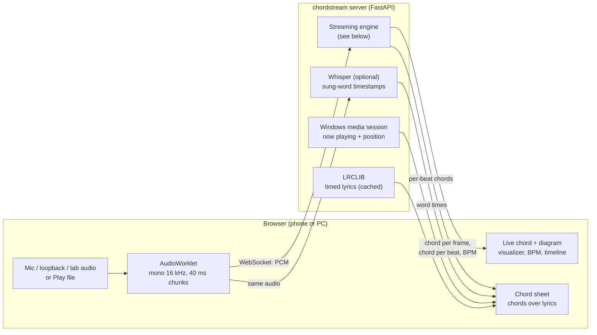
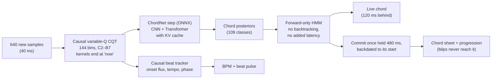
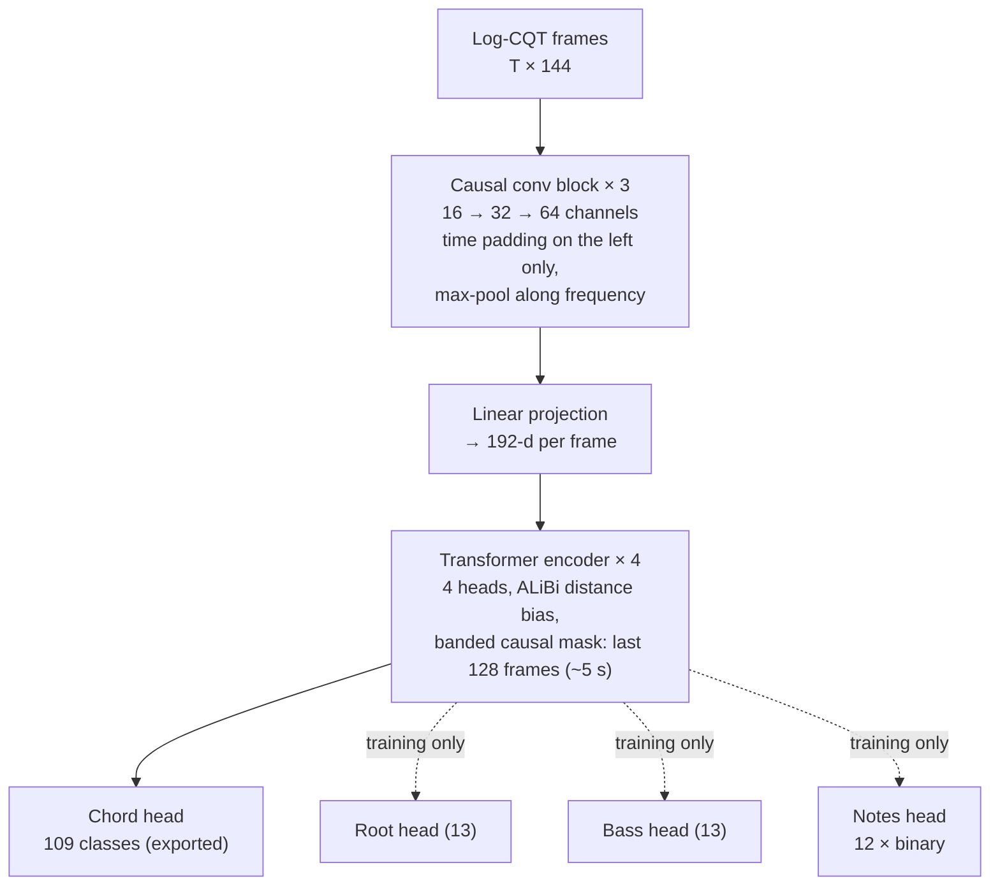
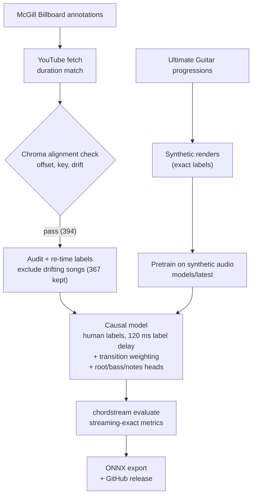

# chordstream

Real-time chord recognition from live audio. Each 40 ms of audio produces one decision, computed
only from audio already heard. The live model (v7) names the chord of the audio 120 ms ago: that
short, trained-in delay lets each decision hear a little of what follows, which removes much of
the flicker at chord changes. It names 108 chords (12 roots × maj, min, 7, maj7, m7, dim, aug,
sus2, sus4) plus "no chord", and is trained on human-labelled data only.

## Architecture

### System

Audio comes from a microphone, a loopback device, a shared tab or a local file. The browser streams
16 kHz PCM over a WebSocket, and the server answers each 40 ms frame with a chord event. The chord
sheet combines those events with the song's timed lyrics.



### Streaming engine (one 40 ms step)

Everything is causal: each step uses only audio up to "now". The network is trained to name the
chord of 3 frames earlier (label delay, 120 ms), so its decision for a frame has heard 120 ms past it. The network runs incrementally, with
the CNN on its 13-frame receptive field and a per-layer KV cache, so a step costs about 2–3 ms of CPU.



### Model (ChordNet)



The extra heads let rare chords and power chords (which have no class) still teach the shared layers.
Training targets are shifted 3 frames later (label delay), so output t names the chord at t − 3;
the network itself is unchanged. An offline teacher (the same network with a symmetric ±5 s band) is
kept only as a measuring stick: since v7 nothing is distilled from it.

### Training pipeline



Every experiment behind these choices is in [docs/EXPERIMENTS.md](docs/EXPERIMENTS.md).

## Design notes

| Concern | Choice |
|---|---|
| Frontend | Causal variable-Q CQT, 16 kHz, 640-sample hop (40 ms), 24 bins/oct from C2 (6 octaves). Kernels end at "now"; low bins integrate the past ~0.2 s. |
| Causality | CNN pads time on the left only. Attention uses a causal band of 128 frames (~5 s) with ALiBi bias. Tests check that future input never changes past output. |
| Streaming cost | ONNX runs one step per frame: the CNN sees its 13-frame receptive field, and each layer keeps a 127-entry KV cache. A test checks this matches the full forward pass exactly. |
| Smoothing | HMM **forward filtering** only, never Viterbi backtracking, so smoothing adds no latency. Transitions = self-loop from median chord length plus a chord-change prior. |
| Vocabulary | 109 classes: 12 roots × 9 qualities + N; the first 25 are the classic major/minor set. Richer chords fold into the nearest quality (Cadd9→C, C9→C7, hdim7→dim). Power chords have no class but still train the root/bass/notes heads. |
| UG "grammar" | Supplies (1) the HMM's chord-change matrix, counted in all 12 keys, and (2) progressions for the synthetic-audio renderer. |
| Pitch augmentation | Shift CQT bins by ±semitones and transpose the labels, applied to every training crop. |

## Pretrained models

Trained bundles are attached to GitHub Releases, so they don't bloat git history:

```powershell
gh release download model-v7 --pattern "*.zip" --dir models
Expand-Archive models/chordstream-v7.zip models; uv run chordstream serve --bundle models/v7
```

They were trained on copyrighted recordings, so keep them for personal use.

## Workflow

```powershell
uv sync --extra train --extra mic            # CUDA torch on Windows/Linux

# 1. Grammar from saved Ultimate Guitar pages (parser only, no scraper; check UG's ToS)
uv run chordstream ug-parse path\to\saved_html --out data/ug.jsonl

# 2. Synthetic pre-training audio rendered from those progressions
uv run chordstream synth --progressions data/ug.jsonl --n 2000 --out data/synth

# 3. Real audio for the McGill Billboard annotations (CC0; extract salami + lab archives to data/billboard_raw)
uv sync --all-extras
uv run chordstream fetch-billboard --cookies-from-browser firefox --sleep 8   # resumable
uv run chordstream fetch-billboard --rescore --max-drift 0.3                 # re-tune thresholds offline
#    or pair annotations with audio you own:
uv run chordstream billboard-link --annotations billboard/McGill-Billboard --audio my_audio --out data/billboard

# 4. Cache features, pre-train on synth, fine-tune on real audio
uv run chordstream features data/synth --out data/cache_synth
uv run chordstream train --cache data/cache_synth --out models/pretrain --progressions data/ug.jsonl
uv run chordstream features data/billboard --out data/cache_bb
uv run chordstream train --cache data/cache_bb --init models/pretrain --out models/latest --lr 1e-4 --progressions data/ug.jsonl

# 5. Export + run
uv run chordstream export models/latest
uv run chordstream transcribe song.wav --ref song.lab --print   # simulated live stream + latency stats
uv run chordstream mic                                           # local input device
uv run chordstream serve                                         # http://localhost:8000 browser demo, ws://…/ws
```

Billboard ships annotations only. `fetch-billboard` searches YouTube and picks the result
whose length matches the annotation, preferring "- Topic" label uploads and skipping
live/cover/remix uploads. It then checks every download against its annotation:
- **Offset:** a chroma-vs-triad cross-correlation over ±10 s finds the time offset.
- **Wrong key:** the correct key must beat all 11 transpositions.
- **Drift:** the offsets found for the first and second halves must agree, which rules out
  different edits, re-pitched uploads and wrong songs.

Rejected audio goes to `_rejected/` and every decision is logged in `manifest.jsonl`.
YouTube's terms forbid downloading, so keep the audio local and don't redistribute it.
YouTube often bot-blocks anonymous downloads; `--cookies-from-browser` uses a signed-in
browser session. The fetcher stops after repeated bot or rate-limit errors instead of
retrying.

## Run locally or in Docker?

Train natively, since the GPU is used directly. Run live inference natively too: the
per-frame model is tiny, so CPU ONNX is as fast as a GPU would be, and a container on
Windows cannot open the microphone. The Docker image is a slim, PyTorch-free
deployment target for streaming over the LAN through the WebSocket API:

```powershell
docker build -t chordstream .
docker run -p 8000:8000 chordstream
```

## Live chord sheet

`chordstream serve`, then open http://localhost:8000.

- **Audio input:** use **Listen** with an input device (a mic, or a loopback bus such as a
  Voicemeeter "Out" bus or Stereo Mix), or **System audio** in Chrome/Edge. The level
  meter, spectrum and pitch-class bars (with the detected chord's tones lit) confirm that
  audio is arriving.
- **Now playing:** on Windows the server reads the OS media session (`/api/nowplaying`),
  which gives the title, artist and playback position from Spotify, YouTube Music, browsers
  and so on. It then fetches time-synced lyrics from [LRCLIB](https://lrclib.net)
  (`/api/lyrics`), cached in `data/lyrics_cache/`.
- **Placement:** each chord that holds for ≥ 320 ms is placed above the word being sung at
  that moment, Ultimate Guitar-style. Placement within a line is by timing, so it's
  approximate. Chords outside lyric lines go into Intro or Instrumental rows.
- **Sync controls:** **±** shifts the lyrics against the music, and clicking a lyric line
  as it is sung re-syncs everything. If the player doesn't report a position, clicking a
  line starts a manual clock.
- **Export:** **Copy** or **Download** gives a plain-text chords-over-lyrics sheet.
  `/#listen` auto-starts with the remembered input.

Requires `uv sync --extra desktop` (Windows media-session bindings).

**Word-level sync (optional):** `chordstream serve --asr small`, with `uv sync --extra asr`
and a GPU recommended.
- **Transcription:** every 2 s the server runs faster-whisper over the newest 8 s of audio,
  using the upcoming lyric lines as its prompt, and returns word timestamps (~0.5 s per
  window on an RTX 3050).
- **Alignment:** the page aligns those words to the lyric words with a fuzzy,
  time-constrained DP. Matched words are underlined and become timing anchors. Chords snap
  to the word being sung, and other words are interpolated between anchors.
- **Auto-sync:** line-start anchors correct the lyrics offset automatically. Turn it off
  with the **Auto-sync** toggle.
- **Script:** this works in any script Whisper writes in. Romanized lyrics of non-English
  songs match poorly, because Whisper writes Hindi in Devanagari.

## Results

The live model is **v7**, with an extended vocabulary (maj, min, 7, maj7, m7, dim, aug, sus2,
sus4) and a 120 ms label delay, trained on human labels only. Majmin accuracy is 83.3% on 36 clean
held-out Billboard songs and 83.1% on the original 10 (from 73.8% for the first fine-tuned model);
full-vocabulary accuracy is 73.0%, and it makes 1.48× the reference number of chord changes (v6,
with zero delay: 80.8%, 70.3%, 1.61×). It uses about 2.4 ms of CPU per 40 ms frame. Every experiment, including the ones that didn't help, is in
**[docs/EXPERIMENTS.md](docs/EXPERIMENTS.md)**, with commands and decisions. The batch scripts
are in [`experiments/`](experiments/).

## Using it from other devices on your LAN

Browsers only allow microphone access on
HTTPS pages or localhost, so serve HTTPS with a self-signed certificate:

```powershell
openssl req -x509 -newkey rsa:2048 -nodes -days 825 -keyout data/certs/key.pem -out data/certs/cert.pem `
  -subj "/CN=chordstream" -addext "subjectAltName=DNS:localhost,IP:127.0.0.1,IP:<your LAN IP>"
uv run chordstream serve --host 0.0.0.0 --ssl-certfile data/certs/cert.pem --ssl-keyfile data/certs/key.pem
```

Open `https://<your LAN IP>:8000` and accept the certificate warning once per device. "Now
playing" and the lyrics follow the media playing on the server PC.

If Windows Firewall blocks Python, see [`tools/`](tools/): an admin script to allow it, or a Node
relay on a port that's already open.

## WebSocket protocol

Send binary messages of little-endian float32 mono PCM at 16 kHz, in any chunk size.
Each completed 40 ms frame returns one JSON event:
`{"type":"chord","time":12.36,"label":"A:min","name":"Am","confidence":0.94,"raw_index":22,"changed":false,...}`.
Send the text `reset` between songs. Set `CHORDSTREAM_ONLY_CHANGES=1` to receive only chord changes.

## Tests

`uv run pytest`: chord parsing, UG extraction, CQT pitch alignment, streaming/offline CQT
parity, CNN/Transformer causality, KV-cache step ≡ full forward, HMM anti-flicker.
