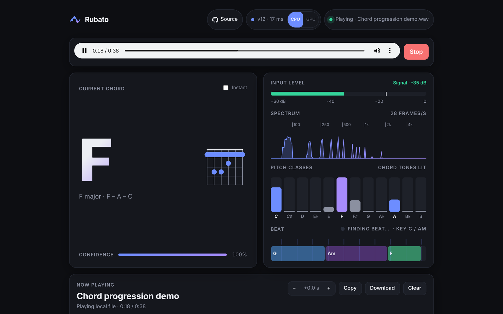
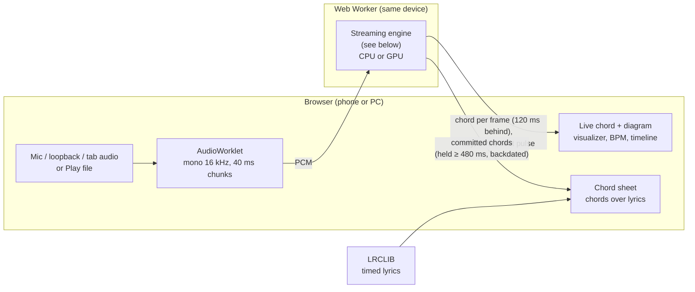
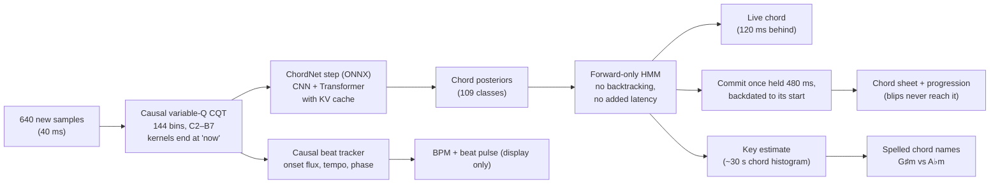
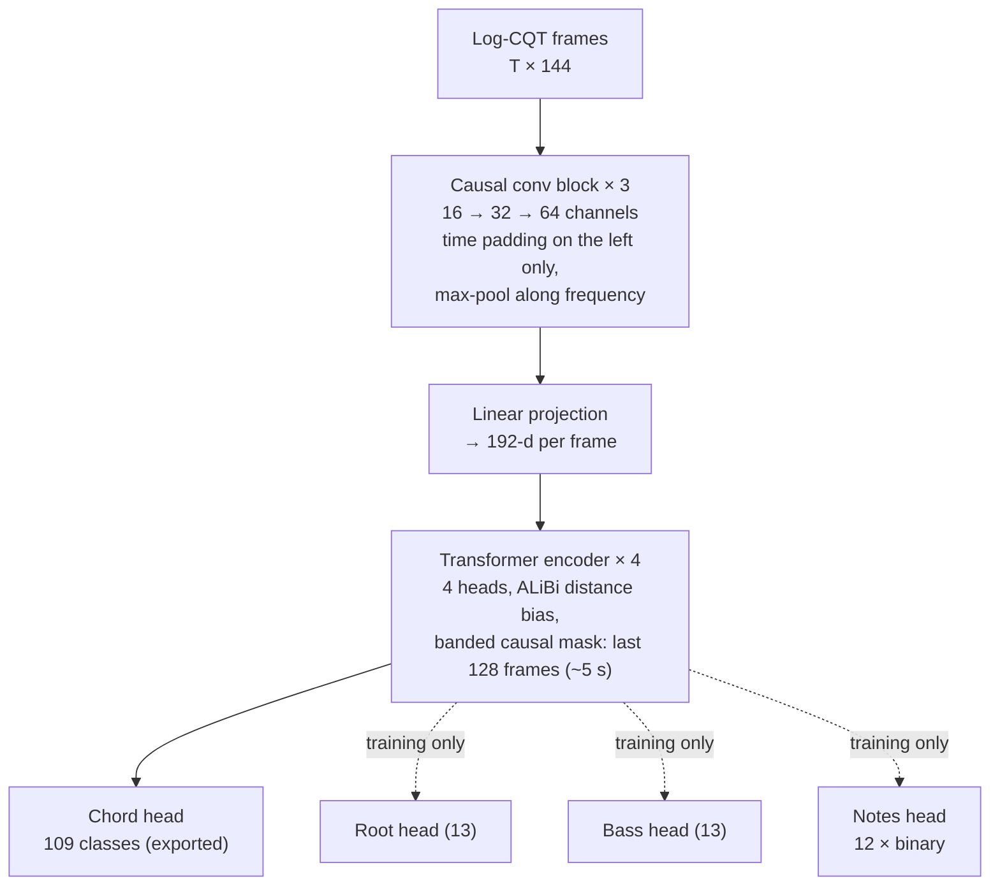
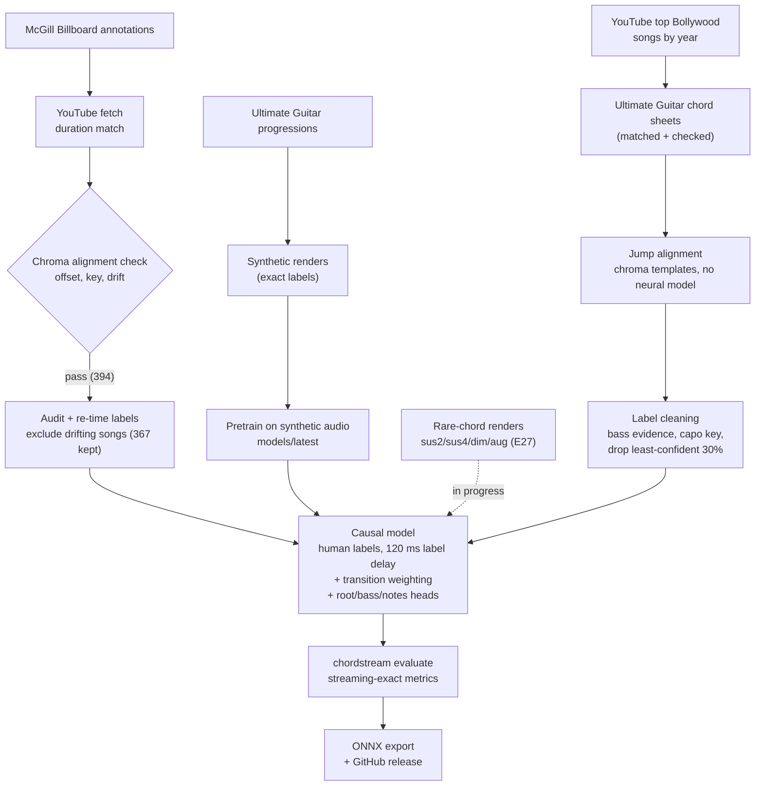

<p align="center"></p>

# Rubato

Real-time chord recognition from live audio, running entirely in the browser:
**https://helloparthshah.github.io/rubato/**. (The Python package and CLI behind it, which train,
evaluate and export the model, are still called `chordstream`.) Each 40 ms of audio produces one decision, computed
only from audio already heard. The live model (v12) names the chord of the audio 120 ms ago: that
short, trained-in delay lets each decision hear a little of what follows, which removes much of
the flicker at chord changes. It names 108 chords (12 roots × maj, min, 7, maj7, m7, dim, aug,
sus2, sus4) plus "no chord", and is trained on human-labelled data only: US Billboard hits plus
Bollywood songs whose chords come from Ultimate Guitar sheets. Chord names are spelled
for the song's estimated key (G♯m in E major, D♭ in A♭ major).



## How it works, step by step

This section follows the sound from the microphone to the chord name on screen. Every step uses
only audio that has already been heard, except the deliberate 120 ms delay in step 4. The diagrams
under [Architecture](#architecture) show the same pipeline.

```
mic / file / system audio
  → 1. browser: mono, 16 kHz, 40 ms chunks ──► engine (Web Worker, same device)
  → 2. CQT: 144 note-pitch energies per 40 ms frame
  → 3. log compression
  → 4. neural network: probabilities for 108 chords + "no chord"
  → 5. HMM smoothing: the live chord
  → 6. key detection + note spelling (C♯ vs D♭)
  → 7. three views: live chord · steady big chord · chord sheet
  (+ beat tracker for the BPM and pulse display)
```

**1. Capturing audio (browser).**
- **Mic or system audio:** the browser opens a 16 kHz stream and resamples the input itself. Echo
  cancellation, noise suppression and auto-gain are switched off, because they are built for speech
  and would damage music.
- **Played file:** it runs at the device's normal rate so it sounds right. A copy is low-passed at
  7 kHz and averaged down to 16 kHz mono.
- **Handing over:** an AudioWorklet gathers 640 samples (40 ms) and passes each chunk to the engine,
  which runs in a Web Worker on the same device. Every chunk becomes exactly one chord decision.

**2. Turning sound into pitches (constant-Q transform).** Chords are sets of notes, so the first job
is measuring how much energy there is at each musical pitch.
- **Range:** 144 bins cover 6 octaves, C2 (65 Hz) to B7 (~3.95 kHz). There are 2 bins per semitone,
  so slightly out-of-tune recordings still land cleanly.
- **How a bin works:** each bin is a filter tuned to its pitch.
  - Low notes need long windows to tell C from C♯: about 0.2 s at 65 Hz. High notes need only ~8 ms.
  - A small variable-Q offset (`gamma` = 3 Hz) shortens the lowest windows, so bass notes don't smear
    across chord changes.
- **No look-ahead:** every window ends at the current sample.
- **Identical features:** the browser engine, the Python engine and the training code compute the
  same numbers, and tests check this.

**3. Log compression.** Each energy becomes `log(1 + 100 × energy)`, which is roughly how the ear
works. A note twice as loud doesn't count twice as much, so quiet inner voices of a chord still
register next to a loud melody note. The result is one row of 144 numbers every 40 ms.

**4. The neural network (the recogniser).** It reads the stream of rows and outputs 109
probabilities: 12 roots × 9 chord types (maj, min, 7, maj7, m7, dim, aug, sus2, sus4) plus "no
chord".
- **Pattern detector (a small CNN):**
  - Three blocks of 2D filters slide over pitch × time. They learn local patterns such as "energy at
    C, E and G", overtone stacks, and note onsets.
  - The filters only look backwards in time.
  - Each block halves the pitch resolution, from 144 bins down to 18 positions × 64 learned
    features. Each output sees 13 frames (~0.5 s).
- **Context (a Transformer):**
  - 4 layers; at each layer the current frame can attend to up to the previous 800 frames (~32 s, about 16 bars), and
    nearer frames count more.
  - This is where musical context enters. If the last few seconds were clearly A major, an ambiguous
    frame leans towards the chords that fit.
- **Streaming:** the engine keeps each layer's memory of past frames (a KV cache), and the CNN computes
  only the newest frame, so each new frame costs one step: about 15–20 ms in a phone or laptop
  browser, 3.6 ms in native Python.
- **The 120 ms delay (E23):** the model is trained so its output at time t names the chord at
  t − 120 ms. Each decision has therefore heard 120 ms of what comes next, which removes much of the
  flicker exactly at chord changes.
- **Training data:** human labels only.
  - ~330 US Billboard songs.
  - 152 Bollywood songs whose chords come from Ultimate Guitar sheets, timed by a chroma-alignment
    step with no neural model involved.
- **Training extras:**
  - Random pitch shifts, so every song also appears in other keys.
  - Training-only outputs for the root, the bass note and each of the 12 notes, which help rare
    chords.
  - Extra weight on frames near chord changes.

**5. HMM smoothing (choosing the live chord).** Network outputs jitter from frame to frame, so a
hidden Markov model filters them using only the past.
- **Steadiness:** a chord tends to last. The model assumes a 5 s average chord, so at each frame there
  is a 99.2% chance the chord continues.
- **Likely next chords:** when the chord changes, the likely successors come from progression
  statistics.
- **Evidence:** each frame's probabilities are first divided by how common each chord was in
  training, so common chords don't win just for being common. They are then squared, which trusts
  the network more and lets clear changes through quickly.
- **Output:** the most likely chord is the live chord, sent with its confidence.

**6. Key detection and spelling.** A rolling history of the chords' notes over the last ~30 s picks
the most likely key. It only switches when another key fits at least 10% better, so it doesn't jump
around. The key decides spelling (C♯m in E major, D♭ in A♭ major) and is shown next to the BPM.

**7. What you see: three views of the same decisions.**

| View | Rule | Trade-off |
|---|---|---|
| Small "hearing D…" line, or the big chord in **Instant** mode | the HMM chord every 40 ms | fastest; flickers (~46 changes/min vs ~26 in real songs) |
| **Big chord (Steady, default)** | switches at once unless the network still gives the old chord ≥ 5%; then the new chord must hold 20 frames (≤ 0.8 s) | ~70% fewer flashes for 0.6 pt accuracy (F05) |
| **Chord sheet and progression** | written only after a chord holds 480 ms, then placed where it actually started | almost exactly the real number of changes; most accurate (F03) |

**Alongside: the beat tracker.** It runs on the same pitch rows. It measures how fast energy rises
(onsets), estimates the tempo and predicts the next beat, which drives the BPM, the pulse dot and the
timeline. It doesn't improve chord accuracy (E05, E16), so it is display-only.

**Known weaknesses** (being worked on; see [docs/EXPERIMENTS.md](docs/EXPERIMENTS.md)):
- **Bass dependence:** v9 fell to 47% on Bollywood without bass (F07). v10–v12, trained with random EQ
  and bass dropout (E32b, E34b), hold 57–59%, and 70–72% with only the bass guitar range removed.
  Inverted chords (C/E) are still named after their bass note about half the time (v12: 53% right,
  up from 44% thanks to the longer context).
- **Brief wrong flashes:** about 6 per minute in the live chord, mostly to the chord a fourth or fifth
  away (F04). The Steady display hides most of them. HMM, display-rule and loss tweaks (F05, F09, F10,
  E36) all trade accuracy for steadiness at the same rate.
- **Room echo:** costs about 5 pt of accuracy but adds no flicker (F06).
- **Off-pitch recordings:** v11/v12 collapse when a recording is tuned more than ~25 cents flat of A440
  (Billboard 32% at −30 cents; F11). Bohemian Rhapsody, which sits flat, scores 68% (75% retuned).
  Detuned training copies fix it on Billboard but cost Bollywood accuracy (E35), and 36 bins/octave
  alone doesn't help (E37).

## Architecture

### System

Audio comes from a microphone, a loopback device, a shared tab or a local file. Everything runs in
the browser: an AudioWorklet hands 16 kHz audio to the engine in a Web Worker, which answers each
40 ms frame with a chord event. The chord sheet combines those events with the song's timed lyrics
from LRCLIB.



### Streaming engine (one 40 ms step)

Everything is causal: each step uses only audio up to "now". The network is trained to name the
chord of 3 frames earlier (label delay, 120 ms), so its decision for a frame has heard 120 ms past it. The network runs incrementally, with
the CNN computing only the newest frame from its 13-frame receptive field and a per-layer KV cache.
It is the same in the browser (`web/engine.js`) and in Python (`stream.py`, used by `transcribe` and
`mic`); `tests/web/parity.mjs` checks they agree frame by frame.



### Model (ChordNet)



The extra heads let rare chords and power chords (which have no class) still teach the shared layers.
Training targets are shifted 3 frames later (label delay), so output t names the chord at t − 3;
the network itself is unchanged. An offline teacher (the same network with a symmetric ±5 s band) is
kept only as a measuring stick: since v7 nothing is distilled from it.

### Training pipeline



Every experiment behind these choices is in [docs/EXPERIMENTS.md](docs/EXPERIMENTS.md).

## Design notes

| Concern | Choice |
|---|---|
| Frontend | Causal variable-Q CQT, 16 kHz, 640-sample hop (40 ms), 24 bins/oct from C2 (6 octaves). Kernels end at "now"; low bins integrate the past ~0.2 s. |
| Causality | CNN pads time on the left only. Attention uses a causal band of 128 frames (~5 s) with ALiBi bias. Tests check that future input never changes past output. |
| Streaming cost | ONNX runs one step per frame: the CNN sees its 13-frame receptive field, and each layer keeps a 127-entry KV cache. A test checks this matches the full forward pass exactly. |
| Smoothing | HMM **forward filtering** only, never Viterbi backtracking, so smoothing adds no latency. Transitions = self-loop (mean chord 5 s) plus a chord-change prior; emissions sharpened with power 2. |
| Look-ahead | **Label delay**: training targets are shifted 3 frames, so output t names the chord at t − 3 and every decision hears 120 ms past its frame. Worth +1.2–2.5 pts and fewer flips vs giving the same delay to the decoder (E23, E25). |
| Chord sheet | The sheet only takes a chord once the live chord has held 480 ms, then backdates it to where it began: about the reference number of chord changes (1.03×) and 83.4% majmin (F03). |
| File playback | Live, as heard: the `<audio>` element plays through a Web Audio context opened with `latencyHint: "playback"` after the file picker closes, and a worklet taps a low-passed 16 kHz copy for the engine. To screen-record on Android, start the recorder *before* choosing the song: Android's recorder only captures sound streams opened after it starts, and the page keeps one stream open for the whole song ([`/static/audiotest.html`](src/chordstream/web/audiotest.html) checks playback routes one by one) |
| Steady display | By default the big chord uses an *evidence hold*: it switches at once when the network has given up on the shown chord, but waits up to 20 frames (800 ms) while the old chord still has ≥ 5% probability. That removes ~70% of blips (6.3 → 1.8/min, 46 → 35 changes/min) for 0.6 pt majmin on Billboard; a plain 480 ms hold would cost 14 pt at display time. The live per-frame guess shows small underneath ("hearing D…"), like a provisional caption. Tick **Instant** to show every decision (F04/F05). |
| Spelling | A decaying (~30 s) histogram of the chords' notes picks the best-fitting key signature (with hysteresis); names use its sharps or flats. Display only. |
| Vocabulary | 109 classes: 12 roots × 9 qualities + N; the first 25 are the classic major/minor set. Richer chords fold into the nearest quality (Cadd9→C, C9→C7, hdim7→dim). Power chords have no class but still train the root/bass/notes heads. |
| UG "grammar" | Supplies (1) the HMM's chord-change matrix, counted in all 12 keys, and (2) progressions for the synthetic-audio renderer. |
| Pitch augmentation | Shift CQT bins by ±semitones and transpose the labels, applied to every training crop. |

## Pretrained models

Trained bundles are attached to GitHub Releases, so they don't bloat git history:

```powershell
gh release download model-v12 --pattern "*.zip" --dir models
Expand-Archive models/chordstream-v12.zip models; uv run chordstream transcribe song.wav --bundle models/v12 --print
```

They were trained on copyrighted recordings, so keep them for personal use. The browser-only site
loads `chordstream-v12-web.zip` from the same release.

## Workflow

```powershell
uv sync --extra train --extra mic            # CUDA torch on Windows/Linux

# 1. Grammar from saved Ultimate Guitar pages
uv run chordstream ug-parse path\to\saved_html --out data/ug.jsonl

# 2. Synthetic pre-training audio rendered from those progressions
uv run chordstream synth --progressions data/ug.jsonl --n 2000 --out data/synth

# 3. Real audio for the McGill Billboard annotations (CC0; extract salami + lab archives to data/billboard_raw)
uv sync --all-extras
uv run chordstream fetch-billboard --cookies-from-browser firefox --sleep 8   # resumable
uv run chordstream fetch-billboard --rescore --max-drift 0.3                 # re-tune thresholds offline
#    or pair annotations with audio you own:
uv run chordstream billboard-link --annotations billboard/McGill-Billboard --audio my_audio --out data/billboard

# 4. Cache features and pre-train on synthetic audio (the init every model starts from)
uv run chordstream features data/synth --out data/cache_synth
uv run chordstream train --cache data/cache_synth --out models/latest --progressions data/ug.jsonl

# 5. Real-audio labels: cache, audit, re-time/clean (E14), extended-vocabulary twin (E18)
uv run chordstream features data/billboard --out data/cache_bb
uv run chordstream audit --cache data/cache_bb --out data/audit.csv
uv run chordstream clean                        # -> data/cache_bb_fix (367 songs)
uv run chordstream build-ext                    # -> data/cache_ext

# 6. Bollywood labels (E21; see below), then the mixed training folder
#    powershell -File experiments/2026-11-12_bollywood_scale.ps1 collects songs -> data/cache_bolly3;
#    experiments/2026-11-12_bollywood_scaled_train.ps1 builds data/cache_ext_bolly3x2

# 7. Train the live recipe (v12 = E38: v10 recipe with 32 s attention context, batch 8), evaluate, export
uv run chordstream train --init models/latest --cache data/cache_ext_bolly3x2 --vocab extended --label-delay 3 `
    --lr 3e-4 --epochs 80 --crops 2000 --transition-weight 3 --random-eq 0.5 --bass-dropout 0.3 `
    --context 800 --batch-size 8 --out models/v12
uv run python experiments/hmm55.py models/v12   # deployed HMM (5 s / power 2, see EXPERIMENTS E25) -> models/v12_h5p2
uv run chordstream evaluate models/v12_h5p2 --cache data/cache_ext
uv run python experiments/analysis_bollywood.py --v3 models/v12_h5p2   # 61 Bollywood test songs
uv run python experiments/analysis_bass.py models/v12_h5p2            # robustness without bass
uv run chordstream export models/v12_h5p2       # ONNX + parity check

# 8. Ship to the browser site (see "Browser version" below), or run the Python engine locally
uv run chordstream transcribe song.wav --ref song.lab --print   # simulated live stream + latency stats
uv run chordstream mic                                           # local input device
```

**Bollywood data and rare chords** (see [docs/EXPERIMENTS.md](docs/EXPERIMENTS.md) E21, E27):

```powershell
# E27: rare chord types from synthetic renders (training-only files, prefix synthx)
uv run chordstream synth --rare --n 400 --out data/synth_rare
uv run chordstream features data/synth_rare --extended synthx --out data/cache_rare

# E21: Bollywood songs with human chord labels from Ultimate Guitar sheets
uv run chordstream bollywood songs       # YouTube top-songs playlists, 2010-2024
uv run chordstream bollywood sheets      # match UG "Chords" sheets (requests spaced 1.5 s)
uv run chordstream bollywood validate    # drop look-alike / wrong-song matches
uv run chordstream bollywood audio       # download matched songs (Firefox session)
uv run chordstream bollywood cache       # CQT + sheet jump alignment -> data/cache_bolly
uv run chordstream bollywood clean       # cleaner labels: bass-aware alignment, capo key, low-confidence frames ignored -> data/cache_bolly2
```

The Bollywood stage fetches UG search and tab pages at a slow rate for personal research; check
Ultimate Guitar's terms before running it, and keep the sheets local.

Billboard ships annotations only. `fetch-billboard` searches YouTube and picks the result
whose length matches the annotation, preferring "- Topic" label uploads and skipping
live/cover/remix uploads. It then checks every download against its annotation:
- **Offset:** a chroma-vs-triad cross-correlation over ±10 s finds the time offset.
- **Wrong key:** the correct key must beat all 11 transpositions.
- **Drift:** the offsets found for the first and second halves must agree, which rules out
  different edits, re-pitched uploads and wrong songs.

Rejected audio goes to `_rejected/` and every decision is logged in `manifest.jsonl`.
YouTube's terms forbid downloading, so keep the audio local and don't redistribute it.
YouTube often bot-blocks anonymous downloads; `--cookies-from-browser` uses a signed-in
browser session. The fetcher stops after repeated bot or rate-limit errors instead of
retrying.

## Live chord sheet

- **Audio input:** **Listen** with an input device (a mic, or a loopback bus such as a Voicemeeter
  "Out" bus or Stereo Mix), **System audio** (Chrome/Edge on a computer: share a tab or the screen
  with audio), or **Play file** to play a song in the page. Phone browsers can't share other apps'
  audio, so on a phone use the mic or Play file. The level meter, spectrum and pitch-class bars (with
  the detected chord's tones lit) confirm that audio is arriving.
- **Lyrics:** time-synced lyrics come from [LRCLIB](https://lrclib.net), looked up from the file name
  ("Artist - Title.mp3") when playing a file, or with the search box.
- **Placement:** the engine commits a chord to the sheet once it has held 480 ms, backdated to
  where it began, and the page places it above the word being sung at that moment, Ultimate
  Guitar-style. Short blips appear only in the small "hearing …" line (or the big chord in Instant
  mode), never on the sheet. Words are timed by their position within the line, so placement within
  a line is approximate. Chords outside lyric lines go into Intro or Instrumental rows.
- **Sync controls:** a played file drives the clock. Otherwise click a lyric line as it is sung to
  start a manual clock; **±** shifts the lyrics against the music.
- **Export:** **Copy** or **Download** gives a plain-text chords-over-lyrics sheet.
  `/#listen` auto-starts with the remembered input.

## Gold labels for the Bollywood test songs

`uv run chordstream serve`, then http://127.0.0.1:8000/annotate, opens a correction page for the
61 Bollywood test songs (E21/E28); it is the only part of chordstream that still runs as a local
server, since it reads the songs' audio and writes labels to `data/`. It
loads a song's audio and its sheet-aligned chords on a zoomable timeline; you play it (optionally
slower, looping one segment), click a segment and press **1–9** for the sheet's chords (**0** =
no chord, **X** = unsure, excluded from scoring), drag boundaries, **S**plit at the playhead or
**M**erge, and **P** plays the selected chord so it can be compared by ear. Changes auto-save to
`data/bollywood/gold/<id>.json`; **Mark song done** makes the Bollywood benchmark score that song
against the hand-corrected labels instead of the aligned ones.

## Results

The live model is **v12**: v10's recipe (extended vocabulary, 120 ms label delay, human labels only,
Billboard + 152 Bollywood songs, **random EQ** and **bass dropout** so chords come from the harmony
rather than the bass line) with **32 s of attention context** instead of 5 s (E34b → v11 at 16 s,
E38 → v12 at 32 s). The longer context gains about 3 points on normal audio and 9 on inverted chords.
Models are chosen by cost-benefit across both test sets.

| | v12 (live) | v11 | v10 | v9 | v7 |
|---|---|---|---|---|---|
| Bollywood, 61 test songs, majmin / full | **82.4% / 79.8%** | 81.0% / 78.4% | 79.1% / 76.5% | 80.0% / 77.4% | 60.7% / 54.0% |
| Bollywood, bass removed below 150 / 300 Hz | 71.6% / 56.5% | 70.5% / 56.9% | **71.9% / 58.5%** | 66.8% / 46.8% | – |
| Billboard, 36 clean held-out songs, majmin / full | 82.5% / 72.8% | 81.5% / 71.0% | 79.5% / 66.8% | 80.2% / 67.7% | **83.3% / 73.0%** |
| Billboard, bass removed below 150 / 300 Hz | **80.8% / 73.8%** | 79.6% / 72.6% | 78.1% / 71.0% | 76.4% / 65.2% | – |
| Inverted chords (C/E), Billboard | **52.8%** | 49.7% | 43.5% | 46.6% | – |
| Steady display, chord changes per minute (Billboard / Bollywood; songs: 28 / 41) | 32.9 / 46.6 | 33.8 / 43.3 | 36.7 / 38.7 | – | – |
| **Overall** (mean of the two test sets, majmin) | **82.5%** | 81.3% | 79.3% | 80.1% | 72.0% |
| Chord sheet (480 ms hold, v7) | – | – | – | – | 83.4% majmin, 1.03× changes |

Bollywood accuracy is measured against sheet-aligned labels (about 82–84% accurate when checked on
Billboard); hand-corrected gold labels from the annotate page replace them song by song. The
first fine-tuned model scored 73.8% on Billboard's original 10. A step costs about 3.6 ms of CPU per
40 ms frame (v12; 2.7 ms for v11 in the same run, 5.0 ms p99). Every experiment, including the ones that didn't help, is in
**[docs/EXPERIMENTS.md](docs/EXPERIMENTS.md)**, with commands and decisions. The batch scripts
are in [`experiments/`](experiments/).

## Browser version (GitHub Pages)

**https://helloparthshah.github.io/rubato/** runs everything in the browser: no server, and the
audio never leaves the device. A CPU / GPU toggle in the model badge picks where the model runs:
CPU (WebAssembly, the default) or GPU (WebGPU: Chrome, Edge, recent Safari and Firefox). The choice
is remembered per device. One step is so small that the CPU is often the faster (a phone: CPU 15 ms
vs GPU 40 ms per 40 ms frame; a laptop CPU about 20 ms). While listening, the badge shows the
compute time per step, in red above 40 ms (the engine is falling behind real time). The badge is
separate from the audio status. The display runs on an audio clock (audio captured so far), not on
engine events: the timeline, beat pulse and visualizer stay smooth if the engine falls behind, the
not-yet-recognised stretch shows as a faint band, and chords are placed on the lyrics by audio time. `?provider=webgpu` or `?provider=wasm` overrides the toggle. Phone
browsers can't share other apps' audio
with a web page, so on a phone use the mic or play the song as a file in the page. Lyrics come
straight from LRCLIB. (An earlier desktop server added Windows "now playing" detection and Whisper
word alignment; both were dropped with it.)

- The engine ([`web/engine.js`](src/chordstream/web/engine.js)) is a port of the Python live path:
  causal CQT, the ONNX step model (onnxruntime-web, in a Web Worker), causal HMM, beat tracker, key
  spelling, chord sheet and Steady display. On 90 s of a test song, every decision is identical to the
  Python engine (`tests/web/parity.mjs`).
- `bench.html` on the site times both backends on your device.
- Deploy: `.github/workflows/pages.yml` builds the site on every push that touches `src/chordstream/web/`.
  To ship a new model, export the web bundle and attach it to that model's release, then set
  `WEB_MODEL` in the workflow:

```powershell
uv run chordstream export-web models/v12 --out site/model   # also re-exports the ONNX step model
# zip meta.json, model.onnx, state.bin, hmm.bin -> chordstream-v12-web.zip, then:
gh release upload model-v12 site/chordstream-v12-web.zip
```

Local test build: `cd tests/web; npm ci; npm run parity` (needs `tests/web/make_reference.py` output in
`data/webtest`), then `python scripts/build_site.py --model site/model --out _site` and serve `_site`.

## Chord events

The engine (`Engine.push` in `web/engine.js`, `ChordStream.push` in `stream.py`) takes float32 mono
PCM at 16 kHz in any chunk size and returns one event per completed 40 ms frame:
`{"type":"chord","time":12.36,"label":"A:min","name":"Am","confidence":0.94,"raw_index":22,"changed":false,"delay":0.12,"key":"C / Am",...}`.

| Field | Meaning |
|---|---|
| `time` | stream time at the end of the newest frame (s) |
| `label`, `name`, `index` | chord of the audio at `time − delay` (Harte label, key-spelled display name, class) |
| `delay` | the model's label delay in seconds (0.12 for v12) |
| `key` | estimated key signature, e.g. `"E / C#m"`, once known |
| `beat`, `bpm`, `beat_conf` | causal beat tracker (display only) |
| `display_label`, `display_name` | the steady-display chord (evidence hold, F05), shown big unless Instant is ticked |
| `beat_label`, `beat_name`, `beat_t0` | set when a chord is committed to the sheet: the chord and its start time (described time) |
Call `reset()` between songs.

## Tests

`uv run pytest`: chord parsing (Harte, free text, extended), UG extraction, CQT pitch alignment,
streaming/offline CQT parity, CNN/Transformer causality, KV-cache step (newest-frame CNN cone only) ≡ full forward (also for the
optional sheet head), label-delay targets and realignment, HMM anti-flicker, key-aware spelling.
Browser engine vs Python engine: `cd tests/web; npm ci; npm run parity` (see the browser version section).
